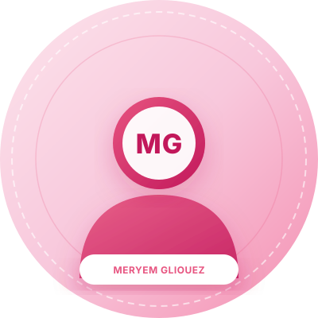

# Meryem Gliouez — Personal Portfolio Website

A modern, responsive, and elegant personal portfolio built for **Meryem Gliouez**, Data Science Engineering student at École Polytechnique de Sousse, Tunisia.

Designed to showcase engineering expertise, technical projects (including **Nexus AI — Enterprise AI Assistant**), skills, and academic achievements to recruiters and industry peers.

---

## 🌟 Key Features

- **Data Science & AI Aesthetic**: Clean slate & tech-teal color scheme optimized for data science, machine learning, and AI developers.
- **Dark / Light Mode**: Seamless theme toggle preserving user preferences using `localStorage`.
- **Fully Responsive**: Mobile, tablet, and desktop friendly with a responsive navigation drawer.
- **Accessible & Semantic HTML5**: Screen-reader friendly, keyboard navigatable with standard ARIA attributes.
- **Projects Showcase & Interactive Modal**:
  - Detailed card and modal overview for **Nexus AI — Enterprise AI Assistant** (RAG, ChromaDB, Groq API, LangGraph, RAGAS, Streamlit).
  - Clearly demarcated editable placeholders for upcoming Data Analytics and Python projects.
- **Skills Matrix**: Categorized into Programming, AI/ML & GenAI, Data Analytics & Science, Databases, and Tools with explicit distinction for confirmed vs. suggested skills.
- **Zero Heavy Dependencies**: Pure standard HTML5, CSS3, and Vanilla JavaScript. Fast loading and ready for free static hosting (GitHub Pages).

---

## 📂 Project Structure

```text
meryem-portfolio/
│
├── index.html        # Main HTML structure with semantic sections
├── styles.css        # Responsive styling, design tokens & dark/light themes
├── script.js         # Interactive behavior (theme toggle, mobile nav, modals, scroll spy)
├── .gitignore        # Standard ignore file for cleaner repository
└── README.md         # Documentation & deployment guide
```

---

## 🚀 How to Run Locally

You do not need any compilers or Node.js to run this portfolio.

### Option 1: Direct Browser Open (Simplest)
Double-click `index.html` or right-click `index.html` and select **Open with > Chrome / Firefox / Edge**.

### Option 2: Using VS Code Live Server (Recommended for development)
1. Open this folder in VS Code.
2. Install the **Live Server** extension (by Ritwick Dey).
3. Click **"Go Live"** in the bottom status bar or right-click `index.html` -> **Open with Live Server**.

### Option 3: Using Python Built-in Server
If you have Python installed, open PowerShell or Terminal in this folder and run:
```bash
python -m http.server 8000
```
Then visit [http://localhost:8000](http://localhost:8000) in your browser.

---

## 🌐 Publishing to GitHub Pages (Free Hosting)

When you are ready to publish your portfolio to the world:

1. **Initialize Git and Commit**:
   ```bash
   git init
   git add .
   git commit -m "Initial commit: Meryem Gliouez portfolio website"
   ```

2. **Create a GitHub Repository**:
   - Go to [github.com/new](https://github.com/new).
   - Name your repository (e.g., `portfolio` or `meryemgliouez.github.io`).
   - Leave it public and do not initialize with README (you already have one).

3. **Push your code**:
   ```bash
   git remote add origin https://github.com/meryemgliouez/<YOUR-REPO-NAME>.git
   git branch -M main
   git push -u origin main
   ```

4. **Enable GitHub Pages**:
   - In your GitHub repository, go to **Settings** > **Pages** (under Code and automation in the left sidebar).
   - Under **Build and deployment > Source**, choose **Deploy from a branch**.
   - Under **Branch**, select `main` and folder `/ (root)`.
   - Click **Save**.
   - Within 1–2 minutes, your website will be live at `https://meryemgliouez.github.io/<YOUR-REPO-NAME>/`.

---

## 🎨 Visual Identity & Color Palette

The portfolio features an elegant, modern pink palette suited for a Data Science & AI Engineering student:
- **Soft pastel pink**: `#F8C8DC`
- **Light blush pink**: `#FCE4EC`
- **Rose pink**: `#E75480`
- **Deep rose**: `#C2185B`
- **Pure white**: `#FFFFFF`
- **Soft dark gray**: For clean, accessible text readability

Both **Light Mode** and **Dark Mode** are supported with automatic persistent storage via `localStorage`.

---

## 📸 How to Add or Replace Your Personal Photo

1. Prepare your preferred personal portrait or headshot (e.g., in `.jpg` or `.png` format).
2. Save or copy your photo into the `assets/` folder:
   ```text
   assets/profile.jpg
   ```
3. Open `index.html` and find line 118:
   ```html
   
   ```
4. Change `src="assets/profile-placeholder.svg"` to:
   ```html
   
   ```
   *Your image will automatically fit into the circular portrait frame with rose gradient borders, soft shadows, and hover animations.*

---

## ✏️ Customizing Placeholders

- **LinkedIn URL**: Replace `https://www.linkedin.com/` in `index.html` with your direct LinkedIn profile handle (e.g., `https://www.linkedin.com/in/meryem-gliouez`).
- **Additional Projects**: Update the project cards marked with `Editable Placeholder` in `index.html` with your specific repositories, live demo links, and descriptions.
- **Skills**: Adjust the `suggested` skill tags in the Skills section to reflect your exact course modules and comfort level.
